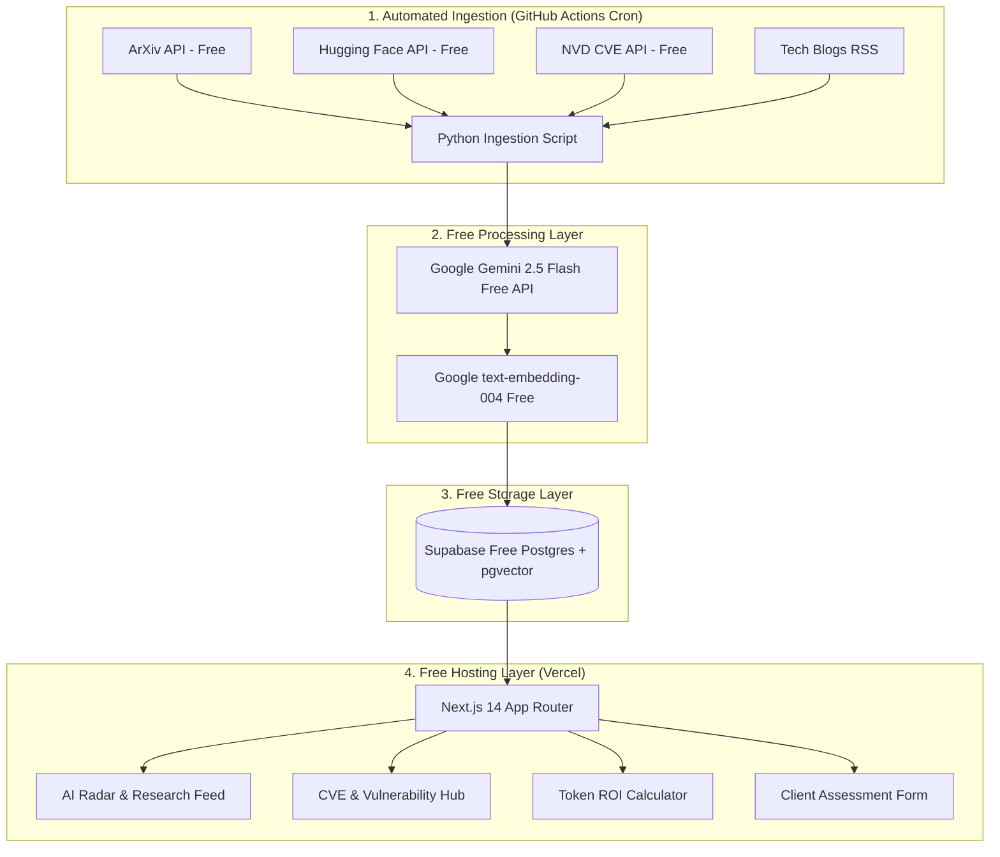

# NexusAI Advisory Platform: PRD & Zero-Cost Implementation Guide

**Author:** AI Architecture & Advisory Lead  
**Target Developer:** Junior Full-Stack Engineer (Next.js / Python / Supabase)  
**Status:** Approved for Development  
**Operating Infrastructure Cost:** **$0.00 / month (100% Free Tier Stack)**  
**Version:** 1.1  

---

## Part 1: Product Requirement Document (PRD)

### 1. Executive Summary & Core Objectives

**NexusAI** is an automated intelligence gathering, blueprint repository, and client lead-generation platform designed for a Software Engineering Manager transitioning into an AI Architecture & Advisory business.

The platform operates on a **100% Free / Open-Source Stack**, eliminating monthly server or API expenses during development and initial market launch:

1. **Internal AI Radar & Skill Hub**: Automatically pulls daily research papers (ArXiv), CVE security vulnerabilities, model benchmarks, and production patterns into a searchable knowledge base.
2. **Client-Facing Advisory Assets**: Exposes an interactive **AI Readiness Assessment Tool** and **Token Cost Estimator** to attract enterprise discovery leads.

---

### 2. User Personas

| Persona | Role | Key Goals | Key Constraints |
| :--- | :--- | :--- | :--- |
| **AI Advisor (Primary)** | Software Engineering Manager | Track daily AI breakthroughs, model releases, security threats, and design patterns. | Zero infrastructure budget during practice bootstrap phase. |
| **Enterprise Client (Secondary)** | CTO / VP of Eng / Product Lead | Assess corporate AI readiness, calculate LLM token budgets, select battle-tested architectures. | Wants quick estimates and reference architectures without complex sales calls. |

---

### 3. Functional Requirements

#### Module 1: Automated AI Radar & Intelligence Engine (Priority: P0)
* **Free Data Feed Ingestion**: Scrape daily entries from:
  * ArXiv API (`cs.AI`, `cs.CL`, `cs.LG`)
  * Hugging Face Daily Papers API & Trending Models
  * NVD (National Vulnerability Database) CVE API
  * Official Tech RSS Feeds (OpenAI, Anthropic, Google DeepMind)
* **Zero-Cost LLM Summarization**: Process text using **Google Gemini API Free Tier** (`gemini-2.5-flash`) or **Groq API Free Tier** (Llama 3.3 70B):
  * Produce 3 executive takeaways.
  * Classify security impact and architectural patterns.
  * Generate 768-dimension vector embeddings using Google `text-embedding-004` (Free API).

#### Module 2: AI Security & Governance Vulnerability Hub (Priority: P0)
* **CVE Monitoring**: Filter NVD API feeds for keywords (`LLM`, `Prompt Injection`, `LangChain`, `LlamaIndex`, `vLLM`).
* **Governance Framework Mapping**: Map vulnerability items to OWASP Top 10 for LLMs and NIST AI Risk Management Framework checklists.

#### Module 3: Blueprint Vault & Interactive ROI Calculator (Priority: P1)
* **Mermaid.js Blueprint Viewer**: Render client-side interactive flowcharts for Enterprise RAG, Multi-Agent Swarms, and Guardrail Pipelines.
* **Token & Cloud Cost Estimator**: Interactive calculator computing monthly API spend based on expected tokens and call volumes using the cost formula:

$$\text{Monthly Cost} = \left(\frac{\text{Queries/Day} \times \text{Tokens/Query}}{1,000,000}\right) \times 30 \times \text{Price per 1M Tokens}$$

#### Module 4: Client AI Readiness Widget (Priority: P1)
* **Self-Service Assessment Form**: 10-question survey evaluating data readiness, governance, and enterprise infrastructure.
* **Lead Capture & Scoring**: Store submissions in Supabase Free Database and output a downloadable score report.

---

### 4. Database Schema (Supabase PostgreSQL + Free pgvector)

```sql
-- Enable Vector Extension in Supabase (Included Free)
CREATE EXTENSION IF NOT EXISTS vector;

-- Table 1: Ingested Intelligence Items
CREATE TABLE intelligence_items (
    id UUID PRIMARY KEY DEFAULT gen_random_uuid(),
    title VARCHAR(255) NOT NULL,
    source VARCHAR(100) NOT NULL, -- ArXiv, GitHub, NVD, RSS
    url TEXT UNIQUE NOT NULL,
    raw_content TEXT,
    summary_markdown TEXT,
    category VARCHAR(50), -- Architecture, Security, Benchmark, News
    tags TEXT[],
    embedding VECTOR(768), -- Vector dimension for gemini-text-embedding-004
    published_at TIMESTAMP WITH TIME ZONE,
    created_at TIMESTAMP WITH TIME ZONE DEFAULT NOW()
);

-- Table 2: Reference Architecture Blueprints
CREATE TABLE blueprints (
    id UUID PRIMARY KEY DEFAULT gen_random_uuid(),
    title VARCHAR(255) NOT NULL,
    slug VARCHAR(100) UNIQUE NOT NULL,
    description TEXT,
    mermaid_code TEXT NOT NULL,
    use_cases TEXT[],
    tradeoffs TEXT,
    created_at TIMESTAMP WITH TIME ZONE DEFAULT NOW()
);

-- Table 3: Client Assessment Submissions (Lead Generation)
CREATE TABLE client_assessments (
    id UUID PRIMARY KEY DEFAULT gen_random_uuid(),
    company_name VARCHAR(255) NOT NULL,
    contact_email VARCHAR(255) NOT NULL,
    score INTEGER NOT NULL,
    assessment_data JSONB NOT NULL,
    created_at TIMESTAMP WITH TIME ZONE DEFAULT NOW()
);

-- RPC Function for Vector Similarity Search
CREATE OR REPLACE FUNCTION match_intelligence (
  query_embedding VECTOR(768),
  match_threshold FLOAT,
  match_count INT
)
RETURNS TABLE (
  id UUID,
  title VARCHAR,
  source VARCHAR,
  url TEXT,
  summary_markdown TEXT,
  similarity FLOAT
)
LANGUAGE plpgsql
AS $$
BEGIN
  RETURN QUERY
  SELECT
    intelligence_items.id,
    intelligence_items.title,
    intelligence_items.source,
    intelligence_items.url,
    intelligence_items.summary_markdown,
    1 - (intelligence_items.embedding <=> query_embedding) AS similarity
  FROM intelligence_items
  WHERE 1 - (intelligence_items.embedding <=> query_embedding) > match_threshold
  ORDER BY similarity DESC
  LIMIT match_count;
END;
$$;
```

---

## Part 2: Technical Implementation Plan for Junior Developer

### 1. Zero-Cost Technology Stack Overview

| Layer | Free Tool / Service | Free Tier Limits & Why Selected |
| :--- | :--- | :--- |
| **Frontend Framework** | **Next.js 14+ (App Router)** | Open-source, single repo for UI and serverless API endpoints. |
| **UI Components** | **Tailwind CSS + shadcn/ui** | Open-source, copy-paste production components. |
| **Hosting & CI/CD** | **Vercel (Hobby Tier)** | $0/mo auto-deployments from GitHub with free SSL. |
| **Database & Vector** | **Supabase (Free Tier)** | 500MB PostgreSQL + `pgvector` extension + Auth ($0/mo). |
| **Ingestion Worker** | **GitHub Actions** | 2,000 free runner minutes/month for daily Python scraping. |
| **LLM Inference** | **Google Gemini API Free Tier** | `gemini-2.5-flash` (1,500 free requests per day). |
| **Embeddings API** | **Google `text-embedding-004`** | Free 768-dimension vector generation. |
| **Diagram Engine** | **Mermaid.js** | Client-side javascript rendering of architecture flowcharts. |

---

### 2. High-Level System Architecture Diagram



---

### 3. Automated Ingestion Script Example (`scripts/daily_ingest.py`)

The junior developer must implement this script to run under GitHub Actions daily:

```python
import os
import feedparser
import requests
from supabase import create_client, Client
from google import genai

# Initialize Free Clients
supabase_url = os.environ.get("SUPABASE_URL")
supabase_key = os.environ.get("SUPABASE_SERVICE_ROLE_KEY")
gemini_key = os.environ.get("GEMINI_API_KEY")

supabase: Client = create_client(supabase_url, supabase_key)
ai_client = genai.Client(api_key=gemini_key)

def fetch_arxiv_papers():
    url = "http://export.arxiv.org/api/query?search_query=cat:cs.AI&start=0&max_results=5&sortBy=submittedDate&sortOrder=descending"
    feed = feedparser.parse(url)
    
    for entry in feed.entries:
        title = entry.title.replace('\n', ' ')
        link = entry.link
        summary = entry.summary
        
        # 1. Summarize using Gemini 2.5 Flash (Free Tier)
        prompt = f"Summarize this AI research paper for an enterprise architect in 3 bullet points:\nTitle: {title}\nAbstract: {summary}"
        response = ai_client.models.generate_content(
            model='gemini-2.5-flash',
            contents=prompt,
        )
        summary_md = response.text

        # 2. Generate Vector Embedding using Gemini Free Embedding
        embed_resp = ai_client.models.embed_content(
            model="text-embedding-004",
            contents=title + " " + summary_md,
        )
        embedding = embed_resp.embedding.values

        # 3. Insert into Supabase
        supabase.table("intelligence_items").upsert({
            "title": title,
            "source": "ArXiv",
            "url": link,
            "raw_content": summary,
            "summary_markdown": summary_md,
            "category": "Architecture",
            "tags": ["Research", "Paper"],
            "embedding": embedding
        }, on_conflict="url").execute()

if __name__ == "__main__":
    fetch_arxiv_papers()
    print("Ingestion complete.")
```

---

### 4. Step-by-Step Junior Developer Task Checklist

#### Sprint 1: Account Setup & Scraping Automation (Days 1–5)
- [x] **Task 1.1**: Sign up for free accounts on **Supabase**, **Google AI Studio (Gemini)**, and **Vercel**.
- [x] **Task 1.2**: Execute SQL schema migrations in Supabase to enable `pgvector` and create tables.
- [x] **Task 1.3**: Write Python ingestion script in `scripts/daily_ingest.py`.
- [x] **Task 1.4**: Configure `.github/workflows/daily_ingest.yml` to trigger the Python script daily at 06:00 UTC.

#### Sprint 2: Frontend & Semantic Search Implementation (Days 6–10)
- [ ] **Task 2.1**: Initialize Next.js 14 project with Tailwind CSS (`npx create-next-app@latest`).
- [ ] **Task 2.2**: Build `/intelligence` page displaying ingested cards with category tags.
- [ ] **Task 2.3**: Build `/api/v1/search` route calling Supabase `match_intelligence` RPC function for RAG vector search.

#### Sprint 3: Security Hub, Blueprint Viewer & ROI Calculator (Days 11–15)
- [ ] **Task 3.1**: Build `/security` page listing CVE vulnerabilities pulled from NVD API.
- [ ] **Task 3.2**: Build reactive Token ROI Calculator allowing clients to select LLM vendors (OpenAI vs Anthropic vs vLLM) and calculate monthly costs.
- [ ] **Task 3.3**: Integrate `mermaid.js` component to render blueprint flowcharts from Markdown strings.

#### Sprint 4: Lead Generation & Vercel Deployment (Days 16–20)
- [ ] **Task 4.1**: Create public client survey `/assessment` with 10 questions.
- [ ] **Task 4.2**: Set up Supabase Database Webhook to send instant lead alert emails via free tier of Resend API.
- [ ] **Task 4.3**: Deploy Next.js repository to Vercel and verify $0 operating cost.

---

### 5. Verification & Final Acceptance Criteria

1. **Zero Monthly Bill**: Verify that no paid API subscriptions or server credits are required to run the ingestion or frontend.
2. **Automated Ingestion**: Confirm GitHub Actions executes successfully every day and inserts summarized papers into Supabase.
3. **Fast Vector Search**: Searching "RAG Architecture" returns relevant papers in under 300ms using Supabase `pgvector`.
4. **Responsive UI**: All pages render flawlessly across mobile, tablet, and desktop viewports.